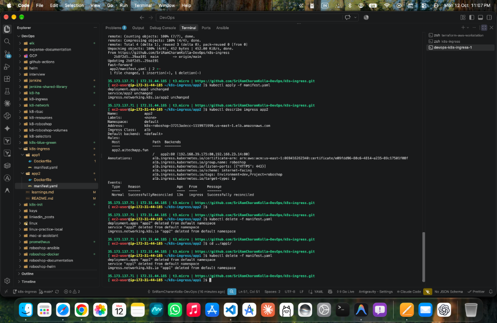
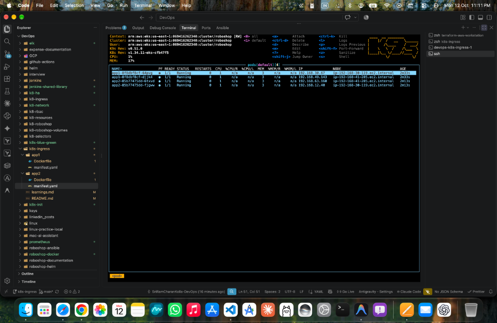
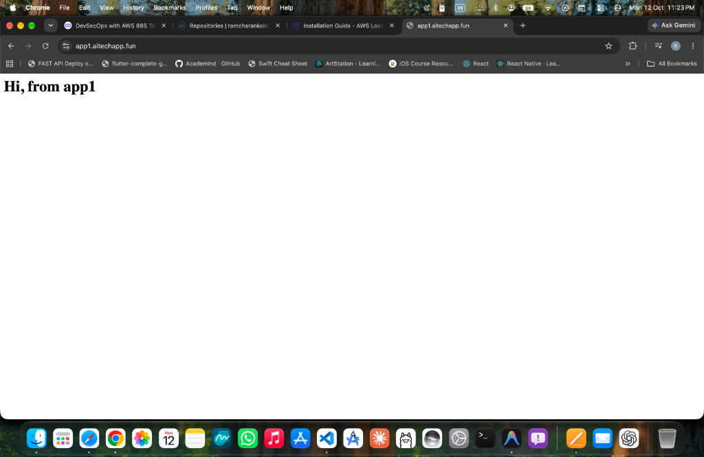
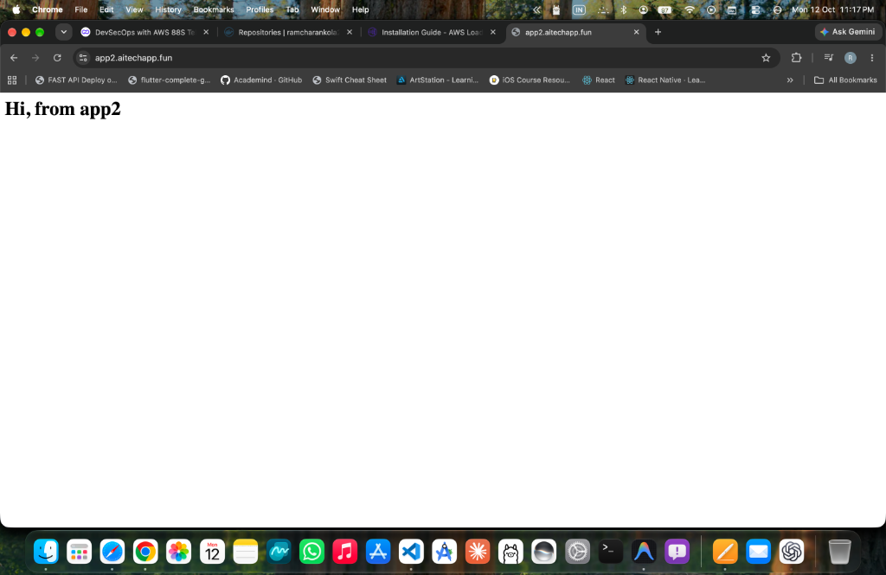

# 🌐 Kubernetes Ingress with AWS Load Balancer Controller (ALB)

A production-grade Kubernetes Ingress implementation deploying multiple containerized microservices (`app1` and `app2`) on Amazon EKS. Features host-based routing through a single shared AWS Application Load Balancer (ALB), automated TLS/SSL termination with AWS Certificate Manager (ACM), and custom domain routing via Amazon Route 53.

---

## 🏗️ Architecture Overview

```text
[ Users on Internet ]
         │
         │ HTTPS (Port 443) with TLS Certificate (*.aitechapp.fun)
         ▼
[ AWS Application Load Balancer (ALB) ] (Shared via group.name: roboshop)
         │
         ├─────────────────────────────────────────┐
         │ Host: app1.aitechapp.fun                │ Host: app2.aitechapp.fun
         ▼                                         ▼
[ Target Group: app1 ] (Target Type: IP)   [ Target Group: app2 ] (Target Type: IP)
         │                                         │
         ▼                                         ▼
   [ Pods: app1 ]                            [ Pods: app2 ]
   (192.168.30.67:80)                        (192.168.63.160:80)
   (192.168.49.143:80)                       (192.168.12.40:80)
```

---

## 🛠️ What I Did in This Project

### 1. Dockerized Applications
* Created custom container images for two microservices:
  * [app1/Dockerfile](./app1/Dockerfile): Lightweight NGINX serving `app1` (`ramcharankola2/app1:1.0.0`)
  * [app2/Dockerfile](./app2/Dockerfile): Lightweight NGINX serving `app2` (`ramcharankola2/app2:1.0.0`)
* Pushed both images to Docker Hub registry.

### 2. AWS EKS IRSA (IAM Roles for Service Accounts)
* Associated IAM OIDC Provider with the EKS cluster:
  ```bash
  eksctl utils associate-iam-oidc-provider \
      --region us-east-1 \
      --cluster roboshop \
      --approve
  ```
* Downloaded the official AWS Load Balancer Controller IAM policy and created it in AWS IAM:
  ```bash
  curl -o iam-policy.json https://raw.githubusercontent.com/kubernetes-sigs/aws-load-balancer-controller/v3.2.1/docs/install/iam_policy.json
  aws iam create-policy \
      --policy-name AWSLoadBalancerControllerIAMPolicy \
      --policy-document file://iam-policy.json
  ```
* Provisioned the Kubernetes Service Account with attached IAM policy:
  ```bash
  eksctl create iamserviceaccount \
      --cluster=roboshop \
      --namespace=kube-system \
      --name=aws-load-balancer-controller \
      --attach-policy-arn=arn:aws:iam::<AWS_ACCOUNT_ID>:policy/AWSLoadBalancerControllerIAMPolicy \
      --override-existing-serviceaccounts \
      --region us-east-1 \
      --approve
  ```

### 3. Deployed AWS Load Balancer Controller
* Installed the controller into `kube-system` using Helm 3:
  ```bash
  helm repo add eks https://aws.github.io/eks-charts
  helm install aws-load-balancer-controller eks/aws-load-balancer-controller \
      -n kube-system \
      --set clusterName=roboshop \
      --set serviceAccount.create=false \
      --set serviceAccount.name=aws-load-balancer-controller
  ```

### 4. Authored Kubernetes Manifests
* **Deployments & Services:** Configured 2 replicas, proper label selectors, and ClusterIP services on Port 80 for both [app1/manifest.yaml](./app1/manifest.yaml) and [app2/manifest.yaml](./app2/manifest.yaml).
* **Ingress Resources (`networking.k8s.io/v1`):**
  * `ingressClassName: alb`
  * Grouping: `alb.ingress.kubernetes.io/group.name: roboshop` (consolidates both apps into 1 single ALB).
  * Direct Pod Routing: `alb.ingress.kubernetes.io/target-type: ip` (bypasses NodePort, registers Pod IPs directly in AWS Target Groups).
  * HTTPS & SSL: `alb.ingress.kubernetes.io/listen-ports: '[{"HTTPS": 443}]'` and ACM certificate binding.
  * Host-based routing rules for `app1.aitechapp.fun` and `app2.aitechapp.fun`.

### 5. SSL/TLS Certificate Setup (ACM)
* Requested a wildcard certificate for `*.aitechapp.fun` in AWS Certificate Manager (`us-east-1`).
* Validated domain ownership by publishing DNS CNAME records into Route 53 until status turned `ISSUED`.

### 6. DNS Routing via Amazon Route 53
* Configured `A` records with Alias pointing directly to the AWS ALB DNS name for both:
  * `app1.aitechapp.fun` $\rightarrow$ ALB Alias
  * `app2.aitechapp.fun` $\rightarrow$ ALB Alias

---

## 📸 Proof of Work & Output

### 1. Ingress Verification & Lifecycle Management
Verification of Ingress reconciliation with AWS Load Balancer Controller, showing the ALB DNS assigned, routing rules configured, and resource deletion:


### 2. Workloads & Pods Running in Cluster
Active pods for `app1` and `app2` running smoothly across worker nodes (monitored via K9s):


### 3. Application 1 Output (`https://app1.aitechapp.fun`)
`app1` successfully loaded over HTTPS with a secure TLS/SSL lock icon:


### 4. Application 2 Output (`https://app2.aitechapp.fun`)
`app2` successfully loaded over HTTPS with a secure TLS/SSL lock icon through the same shared ALB:


---

## 💡 What I Learned (Key Engineering Takeaways)

For in-depth root cause analyses, error codes, and step-by-step troubleshooting, read:
👉 **[learnings.md](./learnings.md)**

### 1. Kubernetes YAML Indentation & Strict Decoding
* In Kubernetes 1.25+, strict schema decoding rejects unexpected fields.
* **Deployment Spec:** `template:` is a sibling of `selector:` under `spec:`, not a child of `selector:`.
* **Ingress Spec:** In `networking.k8s.io/v1`, `paths`, `path`, and `backend` must be strictly nested inside `http:`.

### 2. Ingress Grouping (`group.name`) Saves Infrastructure Costs
* By default, every Ingress creates a separate AWS ALB (~$25/month each).
* Using `alb.ingress.kubernetes.io/group.name: roboshop` allows `app1` and `app2` to share a **single Application Load Balancer**, automatically merging host rules and target groups.

### 3. Ingress Group Lifecycle & Re-creation Gotcha
* If all Ingress resources in a group are deleted (`kubectl delete -f manifest.yaml`), the AWS Load Balancer Controller **automatically deletes the underlying AWS ALB**.
* When re-applied, a **brand new ALB with a new DNS name** is created. Route 53 Alias records must be updated to the new ALB DNS name.

### 4. AWS ALB Listener Requirements for ACM Certificates
* When configuring `listen-ports: '[{"HTTPS": 443}]'`, AWS ELB strictly forbids attaching certificates that are in `Pending validation`.
* It throws `api error UnsupportedCertificate: The certificate ... must have a fully-qualified domain name, a supported signature, and a supported key size`.
* The certificate must be in **`ISSUED`** state before creating the HTTPS listener.

### 5. Controller Reconciliation & Event Retention
* Kubernetes `Events` (`kubectl describe ingress`) are cached for 1 hour; old error messages do not disappear instantly when AWS external state changes.
* The AWS Load Balancer Controller does not watch AWS ACM directly. Re-triggering reconciliation can be forced instantly using:
  ```bash
  kubectl annotate ingress app1 reconcile="$(date +%s)" --overwrite
  ```

### 6. Route 53 Record Naming Best Practices
* In AWS Route 53 hosted zones, the hosted zone name (`.aitechapp.fun`) is automatically appended.
* In the Record Name field, enter only the subdomain prefix (`app1`), not the full FQDN (`app1.aitechapp.fun`), to prevent domain duplication (`app1.aitechapp.fun.aitechapp.fun`) and `DNS_PROBE_FINISHED_NXDOMAIN` errors.